# Air Quality Index (AQI) Prediction using Hybrid CNN-LSTM Deep Learning Model

## An Extension with Meteorological Features, Feature Ablation, and an Early-Warning Module

---

### Comprehensive Technical & Academic Project Report

| Academic Information | Details |
|:---|:---|
| **Project Title** | Air Quality Index (AQI) Prediction using Hybrid CNN–LSTM Deep Learning Model |
| **Institution** | G.L. Bajaj Institute of Technology and Management, Greater Noida |
| **Department** | Computer Science and Information Technology |
| **Project Guide** | Prof. Animesh Malviya |
| **Academic Session** | Final Year B.Tech Project |

**Team Members:**

| Student Name | University Roll Number |
|:---|:---|
| **Sushant Prasad** | 2301920130192 |
| **Shivam Verma** | 2301920130163 |
| **Harshit Giri** | 2401920139005 |
| **Adarsh Raj** | 2401920139001 |

---

## Table of Contents

1. [Abstract](#1-abstract)
2. [Introduction & Problem Statement](#2-introduction--problem-statement)
3. [Literature Review & Research Gaps](#3-literature-review--research-gaps)
4. [System Architecture & End-to-End Pipeline](#4-system-architecture--end-to-end-pipeline)
5. [Data Collection Methodology](#5-data-collection-methodology)
6. [Data Preprocessing & Cleaning](#6-data-preprocessing--cleaning)
7. [AQI Calculation — Indian CPCB Standard](#7-aqi-calculation---indian-cpcb-standard)
8. [Feature Engineering (82 Features)](#8-feature-engineering-82-features)
9. [Sliding Window Sequence Generation](#9-sliding-window-sequence-generation)
10. [Deep Learning Model Architectures](#10-deep-learning-model-architectures)
11. [Training Methodology & Hyperparameters](#11-training-methodology--hyperparameters)
12. [Comparative Model Evaluation Results](#12-comparative-model-evaluation-results)
13. [McNemar's Statistical Significance Tests](#13-mcnemars-statistical-significance-tests)
14. [Extension 1: Meteorological Feature Impact Study](#14-extension-1-meteorological-feature-impact-study)
15. [Extension 2: Step-wise Feature Ablation Study](#15-extension-2-step-wise-feature-ablation-study)
16. [Extension 3: Threshold-Based Early Warning Alert System](#16-extension-3-threshold-based-early-warning-alert-system)
17. [Multi-Model Ensemble Framework](#17-multi-model-ensemble-framework)
18. [Arbitrary Datetime Prediction System](#18-arbitrary-datetime-prediction-system)
19. [Flask Interactive Web Dashboard](#19-flask-interactive-web-dashboard)
20. [Software Testing & Quality Assurance](#20-software-testing--quality-assurance)
21. [Repository Structure & Codebase Overview](#21-repository-structure--codebase-overview)
22. [Technologies, Frameworks & Libraries](#22-technologies-frameworks--libraries)
23. [How to Run and Use the Project](#23-how-to-run-and-use-the-project)
24. [Key Insights & Academic Conclusions](#24-key-insights--academic-conclusions)
25. [Future Scope & Research Directions](#25-future-scope--research-directions)
26. [References & Citations](#26-references--citations)

---

## 1. Abstract

Air pollution in metropolitan areas presents an acute risk to human respiratory health, environmental stability, and regional economies. Delhi, the National Capital Region (NCR) of India, routinely records hazardous Air Quality Index (AQI) levels due to severe seasonal weather patterns, agricultural stubble burning, high vehicular emissions, and industrial operations. Reliable short-term hourly AQI forecasting is essential to trigger timely municipal interventions and public health advisories.

This project designs, implements, and evaluates an end-to-end **Hybrid CNN–LSTM deep learning framework** for 1-step-ahead (hourly) AQI category classification and on-demand datetime forecasting targeting Delhi, India. The system integrates 4 years (2022–2025, 35,064 hourly timestamps) of pollutant concentrations ($\text{PM}_{2.5}, \text{PM}_{10}, \text{NO}_2, \text{SO}_2, \text{CO}, \text{O}_3$) and meteorological variables (temperature, relative humidity, wind speed, surface pressure, dew point) acquired from the Open-Meteo APIs. AQI is computed strictly following the **Indian Central Pollution Control Board (CPCB)** sub-index standard, categorizing air quality into 6 classes: *Good (0), Satisfactory (1), Moderate (2), Poor (3), Very Poor (4), and Severe (5)*.

An extensive feature engineering pipeline creates **82 predictive features** comprising base pollutants, lag structures (1h to 24h), rolling window moving averages (3h to 24h), cyclic trigonometric time encodings, pollutant emission ratios, and meteorological variables. Time-series sequences are generated using a 24-hour sliding window with a chronological 70%/30% train/test split.

Three deep learning architectures are benchmarked: **1D CNN** (Accuracy: 77.82%, F1: 0.7755), **LSTM** (Accuracy: 75.01%, F1: 0.7392), and **Hybrid CNN–LSTM** (Accuracy: 80.64%, F1: 0.8059). The Hybrid model combines 1D convolutional layers (extracting short-term local pollutant pattern motifs) directly coupled into recurrent LSTM layers (capturing temporal memory and long-range trends), achieving statistically significant superiority confirmed via McNemar's tests ($p < 0.001$).

The project makes three core academic contributions beyond baseline classification:
1. **Meteorological Feature Impact Study:** Quantifies the performance delta of incorporating weather variables across all models, proving that 1D CNN benefits from weather data (+0.93% accuracy, +0.012 F1), whereas recurrent architectures prefer pollutant-only signals due to dimensionality trade-offs.
2. **Step-wise Feature Ablation Study:** Evaluates 6 incremental feature sets, demonstrating that rolling averages yield the single highest performance gain (+1.5% F1) and establishing that Step 3 (+ Rolling Averages, 66 features) attains optimal performance (F1: 0.7966).
3. **Threshold-Based Early Warning Module:** Targets hazardous high-risk events (Very Poor and Severe), achieving **93.67% alert precision**, **87.51% alert recall**, and a **90.48% alert F1-score** across 8,941 test hours.

The complete system is operationalized with an **On-Demand Datetime Predictor** for past and future queries, and an interactive **Flask Web Dashboard**.

---

## 2. Introduction & Problem Statement

### 2.1 Background
Urban atmospheric pollution has emerged as one of the most pressing environmental challenges in developing economies. According to the World Health Organization (WHO), over 99% of the world's population breathes ambient air that exceeds WHO air quality guideline thresholds. Particulate matter ($\text{PM}_{2.5}$ and $\text{PM}_{10}$) can penetrate deep into human lung tissue and enter the bloodstream, resulting in cardiovascular disease, asthma, and premature mortality.

Delhi's geographical setting—a landlocked northern basin surrounded by agricultural belts and thermal power stations—leads to severe seasonal atmospheric stagnation. In post-monsoon and winter months (October through February), thermal inversions trap surface-level pollutants, causing AQI values to surpass 400 ("Severe").

### 2.2 Problem Statement
Existing air quality forecasting methods predominantly rely either on classical statistical models (ARIMA, SARIMA) which fail to capture high-order non-linear interactions, or standalone deep learning architectures that focus exclusively on temporal sequence modeling (LSTM/GRU) or spatial pattern extraction (CNN) in isolation. Furthermore, few implementations combine:
- Official Indian CPCB breakpoint sub-index mathematics;
- Multi-scale lag, rolling, cyclic, and ratio feature engineering;
- A rigorous ablation study isolating feature utility;
- A statistical significance evaluation of model superiority;
- A dedicated, high-precision public health early warning module.

### 2.3 Research Objectives
1. **Data Ingestion:** Retrieve 4 continuous years (2022–2025) of hourly atmospheric and meteorological records for Delhi via Open-Meteo APIs.
2. **Standard Compliance:** Formulate the Indian CPCB AQI sub-index calculator and map hourly concentrations to official categories.
3. **Feature Engineering:** Build an 82-dimensional feature space capturing lag temporal memory, multi-horizon trend rolling means, cyclic diurnal/seasonal encodings, emission ratios, and meteorology.
4. **Architectural Comparison:** Design, train, and benchmark 1D CNN, LSTM, and Hybrid CNN–LSTM classifiers under identical sequence conditions.
5. **Statistical Verification:** Perform McNemar's hypothesis testing to determine whether model performance discrepancies are statistically significant.
6. **Extension 1 (Meteorological Analysis):** Quantify the marginal contribution of meteorological features across all architectures.
7. **Extension 2 (Ablation Analysis):** Execute a 6-step ablation study to determine feature category contributions and identify the optimal feature subset.
8. **Extension 3 (Early Warning System):** Construct and evaluate an alert module triggering on hazardous categories (Very Poor and Severe).
9. **Operational Deployment:** Provide an arbitrary datetime predictor and interactive web dashboard.

---

## 3. Literature Review & Research Gaps

| # | Citation | Architecture | Core Contribution | Limitations Addressed in This Project |
|:--|:---|:---|:---|:---|
| 1 | Madan et al. (2026) | CNN–LSTM | Combined spatial-temporal deep learning for urban air quality | Focused on broad classification; lacked step-wise ablation and dedicated health alert quantification. |
| 2 | Nadheer & Aal-Nouman (2026) | CNN–LSTM | Demonstrated hybrid superiority over standalone CNN and LSTM for PM2.5 | Examined only single pollutant; did not apply full multi-pollutant CPCB sub-index calculation. |
| 3 | Çelikten (2026) | Multi-output CNN–LSTM | Jointly predicted PM10 and AQI using weather inputs | Did not quantify statistical significance using McNemar's test or analyze model agreement. |
| 4 | Sri Lakshmi & Jyothi (2026) | LSTM | Evaluated recurrent temporal sequence modeling on Indian cities | High computational cost; lacked convolutional feature extraction prior to recurrent layers. |
| 5 | Tan et al. (2026) | Deep Ensemble | Scaled deep learning across Chinese cities with weather covariates | Did not provide an actionable, low-latency early warning system for high-risk categories. |

### Research Gap Synthesized
This project bridges the gap between theoretical deep learning research and operational public health systems by combining standard Indian CPCB calculations, 82 multi-scale engineered features, rigorous ablation and statistical validation, and an ensemble forecasting tool deployed in a web dashboard.

---

## 4. System Architecture & End-to-End Pipeline

```mermaid
flowchart TD
    subgraph DataIngestion ["1. Data Ingestion (Open-Meteo API)"]
        A1["Air Quality API<br/>PM2.5, PM10, NO2, SO2, CO, O3"]
        A2["Historical Weather API<br/>Temp, Humidity, Wind, Pressure, Dew Point"]
    end

    subgraph Preprocessing ["2. Preprocessing & Quality Assurance"]
        B1["Inner Join on Datetime Index"]
        B2["Linear Interpolation (limit=6)"]
        B3["IQR Winsorization (3.0x IQR)"]
        B4["Non-Negative Clamping (>=0)"]
    end

    subgraph AQIStandard ["3. Indian CPCB AQI Calculation"]
        C1["Sub-Index Linear Interpolation per Pollutant"]
        C2["AQI = max(I_PM2.5, I_PM10, I_NO2, I_SO2, I_CO, I_O3)"]
        C3["Categorization: Good (0) to Severe (5)"]
    end

    subgraph FeatureEng ["4. Feature Engineering (82 Dimensions)"]
        D1["6 Base Pollutants"]
        D2["36 Lag Features (1, 2, 3, 6, 12, 24h)"]
        D3["24 Rolling Means (3, 6, 12, 24h)"]
        D4["8 Cyclic Encodings (sin/cos of hour, doy, dow, month)"]
        D5["3 Pollutant Ratios (PM2.5/PM10, NO2/SO2, CO/O3)"]
        D6["5 Meteorological Variables"]
    end

    subgraph SequenceGen ["5. Normalization & Sequence Generation"]
        E1["StandardScaler (fit on Train Set only)"]
        E2["24-Hour Sliding Windows -> (N, 24, 82)"]
        E3["Chronological Split: 70% Train / 30% Test"]
    end

    subgraph Modeling ["6. Deep Learning Models"]
        F1["1D CNN Classifier"]
        F2["Stacked LSTM Classifier"]
        F3["Hybrid CNN-LSTM Classifier"]
    end

    subgraph Evaluation ["7. Benchmarking & Extensions"]
        G1["Metrics: Accuracy, Precision, Recall, F1"]
        G2["McNemar's Statistical Significance Tests"]
        G3["Extension 1: Weather Impact Comparison"]
        G4["Extension 2: 6-Step Feature Ablation"]
        G5["Extension 3: Early Warning Alerts (Cat 4 & 5)"]
    end

    subgraph Deployment ["8. Operational Systems"]
        H1["Arbitrary Datetime Prediction System"]
        H2["Interactive Flask Web Dashboard"]
    end

    DataIngestion --> Preprocessing
    Preprocessing --> AQIStandard
    AQIStandard --> FeatureEng
    FeatureEng --> SequenceGen
    SequenceGen --> Modeling
    Modeling --> Evaluation
    Modeling --> Deployment
```



---

## 5. Data Collection Methodology

### 5.1 API Source Justification
Data was harvested from the **Open-Meteo API suite** (`air-quality-api.open-meteo.com` and `archive-api.open-meteo.com`). Open-Meteo integrates high-resolution numerical weather prediction models and the Copernicus Atmosphere Monitoring Service (CAMS). Key operational benefits include:
- Completely free and open-source with no API key bottlenecks;
- High rate limits (~10,000 queries/day) enabling batch downloading;
- Seamless historical archive and operational 3-to-5 day forecasting interfaces;
- Continuous hourly granularity for all required pollutants and weather variables.

### 5.2 Target Region & Time Horizon
- **Target Location:** Delhi, India (Latitude: 28.6139°N, Longitude: 77.2090°E)
- **Time Horizon:** January 1, 2022 00:00 UTC to December 31, 2025 23:00 UTC
- **Total Duration:** 4 Full Years (1,461 Days = 35,064 Hourly Observations)
- **Batching Strategy:** Retrieved in 90-day chunks to adhere to network timeouts.

### 5.3 Variables Acquired

| Domain | Variable | Parameter Code | Units | Source Description |
|:---|:---|:---|:---|:---|
| **Pollution** | Particulate Matter ≤ 2.5 µm | `pm2_5` | µg/m³ | Fine combustion particulates |
| **Pollution** | Particulate Matter ≤ 10 µm | `pm10` | µg/m³ | Coarse inhalable dust |
| **Pollution** | Nitrogen Dioxide | `nitrogen_dioxide` | µg/m³ | Vehicular exhaust emission |
| **Pollution** | Sulphur Dioxide | `sulphur_dioxide` | µg/m³ | Coal combustion / industrial |
| **Pollution** | Carbon Monoxide | `carbon_monoxide` | µg/m³ | Incomplete vehicular combustion |
| **Pollution** | Ground Ozone | `ozone` | µg/m³ | Secondary photochemical oxidant |
| **Weather** | 2m Air Temperature | `temperature_2m` | °C | Ambient surface temperature |
| **Weather** | Relative Humidity | `relative_humidity_2m` | % | Moisture saturation percentage |
| **Weather** | 10m Wind Speed | `wind_speed_10m` | km/h | Atmospheric dispersion velocity |
| **Weather** | Surface Pressure | `surface_pressure` | hPa | Barometric pressure |
| **Weather** | 2m Dew Point | `dew_point_2m` | °C | Atmospheric condensation point |

---

## 6. Data Preprocessing & Cleaning

### 6.1 Alignment via Inner Join
The raw pollution dataset (6 columns) and weather dataset (5 columns) are indexed on UTC datetime timestamps and merged using an **inner join**, guaranteeing zero temporal misalignment.

### 6.2 Missing Value Imputation
- **Method:** Bidirectional linear interpolation (`limit=6`, `limit_direction='both'`).
- **Rationale:** Gaps shorter than 6 hours represent transient sensor dropouts where linear continuity is valid.
- **Handling Persistent Gaps:** Any residual missing rows after interpolation are dropped. In practice, less than 0.2% of timestamps required handling.

### 6.3 Outlier Treatment (IQR Winsorization)
- **Method:** Interquartile Range (IQR) based winsorization.
- **Threshold Formula:** Values capped at $[Q_1 - 3.0 \times \text{IQR}, Q_3 + 3.0 \times \text{IQR}]$.
- **Non-Negative Constraint:** Pollutant concentrations are clamped to $\ge 0.0$.
- **Why Capping over Truncation:** Removing rows breaks time-series continuity and invalidates subsequent lag and rolling window operations.

---

## 7. AQI Calculation — Indian CPCB Standard

### 7.1 Mathematical Formulation
The Indian Central Pollution Control Board (CPCB) calculates the overall Air Quality Index using piecewise linear interpolation for each pollutant $p$:

$$I_p = \frac{I_{\text{high}} - I_{\text{low}}}{C_{\text{high}} - C_{\text{low}}} \times (C_p - C_{\text{low}}) + I_{\text{low}}$$

Where:
- $C_p$ is the observed pollutant concentration;
- $[C_{\text{low}}, C_{\text{high}}]$ is the concentration breakpoint bracket enclosing $C_p$;
- $[I_{\text{low}}, I_{\text{high}}]$ is the corresponding index breakpoint bracket.

The overall Air Quality Index is governed by the **maximum operator**:

$$\text{AQI} = \max\left(I_{\text{PM}_{2.5}}, I_{\text{PM}_{10}}, I_{\text{NO}_2}, I_{\text{SO}_2}, I_{\text{CO}}, I_{\text{O}_3}\right)$$

### 7.2 CPCB Breakpoint Tables

| Category | Index Range | $\text{PM}_{2.5}$ (µg/m³) | $\text{PM}_{10}$ (µg/m³) | $\text{NO}_2$ (µg/m³) | $\text{SO}_2$ (µg/m³) | $\text{CO}$ (mg/m³) | $\text{O}_3$ (µg/m³) |
|:---|:---:|:---:|:---:|:---:|:---:|:---:|:---:|
| **Good (0)** | 0–50 | 0–30 | 0–50 | 0–40 | 0–40 | 0–1.0 | 0–50 |
| **Satisfactory (1)** | 51–100 | 31–60 | 51–100 | 41–80 | 41–80 | 1.1–2.0 | 51–100 |
| **Moderate (2)** | 101–200 | 61–90 | 101–250 | 81–180 | 81–380 | 2.1–10.0 | 101–168 |
| **Poor (3)** | 201–300 | 91–120 | 251–350 | 181–280 | 381–800 | 10.1–17.0 | 169–208 |
| **Very Poor (4)** | 301–400 | 121–250 | 351–430 | 281–400 | 801–1600 | 17.1–34.0 | 209–748 |
| **Severe (5)** | 401–500 | 251–500 | 431–600 | 401–600 | 1601–2400 | 34.1–50.0 | 749–1000 |

*Special Note:* Open-Meteo supplies Carbon Monoxide ($\text{CO}$) in µg/m³, which is automatically converted to mg/m³ ($\div 1000$) prior to breakpoint indexing.

---

## 8. Feature Engineering (82 Features)

To capture short-term shocks, long-term trends, diurnal rhythms, and chemical interactions, **82 features** are computed across 6 distinct categories:

```
Total Features = 6 (Base) + 36 (Lag) + 24 (Rolling) + 8 (Cyclic) + 3 (Ratio) + 5 (Meteo) = 82
```

### 8.1 Group 1: Base Pollutants (6 features)
Raw hourly concentrations of $\text{PM}_{2.5}, \text{PM}_{10}, \text{NO}_2, \text{SO}_2, \text{CO}, \text{O}_3$.

### 8.2 Group 2: Lag Features (36 features)
Past values for each pollutant at 6 historical horizons: $t-1\text{h}, t-2\text{h}, t-3\text{h}, t-6\text{h}, t-12\text{h}, t-24\text{h}$.
$$\text{Feature}_{p, k} = C_p(t - k), \quad k \in \{1, 2, 3, 6, 12, 24\}$$

### 8.3 Group 3: Rolling Window Means (24 features)
Moving averages over 4 time windows ($3\text{h}, 6\text{h}, 12\text{h}, 24\text{h}$) for each pollutant to capture persistent accumulation or dispersion:
$$\overline{C}_{p, w}(t) = \frac{1}{w} \sum_{i=0}^{w-1} C_p(t - i), \quad w \in \{3, 6, 12, 24\}$$

### 8.4 Group 4: Cyclic Temporal Encodings (8 features)
Trigonometric transformation of cyclical calendar features preserves boundary continuity (e.g., 23:00 is temporally adjacent to 00:00):
- **Hour of Day:** $\sin\left(\frac{2\pi \cdot h}{24}\right), \cos\left(\frac{2\pi \cdot h}{24}\right)$
- **Day of Year:** $\sin\left(\frac{2\pi \cdot \text{doy}}{365.25}\right), \cos\left(\frac{2\pi \cdot \text{doy}}{365.25}\right)$
- **Day of Week:** $\sin\left(\frac{2\pi \cdot \text{dow}}{7}\right), \cos\left(\frac{2\pi \cdot \text{dow}}{7}\right)$
- **Month of Year:** $\sin\left(\frac{2\pi \cdot m}{12}\right), \cos\left(\frac{2\pi \cdot m}{12}\right)$

### 8.5 Group 5: Pollutant Interaction Ratios (3 features)
Ratios represent physical emission sources with small $\epsilon = 10^{-6}$ added to prevent division by zero:
- $\text{ratio\_pm2\_5\_pm10} = \frac{\text{PM}_{2.5}}{\text{PM}_{10} + \epsilon}$ (Identifies fine vs coarse particulate dominance)
- $\text{ratio\_no2\_so2} = \frac{\text{NO}_2}{\text{SO}_2 + \epsilon}$ (Differentiates vehicular traffic from coal/industrial emissions)
- $\text{ratio\_co\_o3} = \frac{\text{CO}}{\text{O}_3 + \epsilon}$ (Captures combustion efficiency vs photochemical activity)

### 8.6 Group 6: Meteorological Variables (5 features)
Direct physical measurements: Temperature, Relative Humidity, Wind Speed, Surface Pressure, Dew Point.

---

## 9. Sliding Window Sequence Generation

### 9.1 Formulation
A sliding window of size $T = 24$ hours is passed across the standardized feature matrix. For sample index $i$:
- **Input Matrix $X_i$:** $24 \times 82$ tensor corresponding to hours $[i-24, i-1]$;
- **Target Label $y_i$:** Scalar integer category code $\{0, 1, 2, 3, 4, 5\}$ at hour $i$.

### 9.2 Chronological Partitioning (No Shuffling)
Time series data violates the independent and identically distributed (i.i.d.) assumption. Shuffling induces catastrophic data leakage. A strict chronological cut is enforced:
- **Training Set (70%):** ~20,800 sequences (covers 2022 to mid-2024);
- **Testing Set (30%):** ~8,941 sequences (covers late 2024 to end-2025).

The `StandardScaler` is fitted **exclusively on the training partition** and serialized to `artifacts/scaler.joblib`. The test set is transformed using these frozen statistics.

---

## 10. Deep Learning Model Architectures

### 10.1 1D Convolutional Neural Network (CNN)
The 1D CNN treats the 24-hour sequence as a 1D grid over time, using convolutional kernels to extract invariant local patterns (e.g., sudden morning traffic spikes).

```
Input: (batch, 24, 82)
  │
  ▼
Conv1D (64 filters, kernel=3, padding='same', ReLU)
  │
BatchNormalization
  │
Conv1D (128 filters, kernel=3, padding='same', ReLU)
  │
BatchNormalization
  │
MaxPooling1D (pool_size=2)  ──> Shape: (batch, 12, 128)
  │
Dropout (rate=0.3)
  │
Flatten                     ──> Shape: (batch, 1536)
  │
Dense (128 units, ReLU)
  │
Dropout (rate=0.3)
  │
Dense (6 units, Softmax)    ──> Output: (batch, 6)
```
- **Total Trainable Parameters:** ~238,982

### 10.2 Long Short-Term Memory Network (LSTM)
The LSTM processes the sequence step-by-step, using forget, input, and output gates to maintain cell state and capture long-range temporal trends.

```
Input: (batch, 24, 82)
  │
  ▼
LSTM Layer 1 (128 units, return_sequences=True, recurrent_dropout=0.2)
  │
Dropout (rate=0.3)
  │
LSTM Layer 2 (64 units, return_sequences=False, recurrent_dropout=0.2)
  │
Dropout (rate=0.3)
  │
Dense (128 units, ReLU)
  │
Dropout (rate=0.3)
  │
Dense (6 units, Softmax)    ──> Output: (batch, 6)
```
- **Total Trainable Parameters:** ~166,534

### 10.3 Hybrid CNN–LSTM Network (Primary Architecture)
The Hybrid architecture feeds the spatial feature maps produced by the 1D CNN directly into the LSTM recurrent layers. The temporal dimension is preserved without flattening.

```
Input: (batch, 24, 82)
  │
  ├─── CNN Feature Extraction Subnet ───────────────────────────────────────┐
  │   Conv1D (64 filters, kernel=3, padding='same', ReLU)                   │
  │   BatchNormalization                                                    │
  │   Conv1D (128 filters, kernel=3, padding='same', ReLU)                  │
  │   BatchNormalization                                                    │
  │   MaxPooling1D (pool_size=2)  ──> Compressed Shape: (batch, 12, 128)    │
  │   Dropout (rate=0.3)                                                    │
  └─── Direct Tensor Coupling (No Flattening) ──────────────────────────────┘
  │
  ├─── Recurrent Temporal Subnet ───────────────────────────────────────────┐
  │   LSTM Layer 1 (128 units, return_sequences=True, recurrent_dropout=0.2)│
  │   Dropout (rate=0.3)                                                    │
  │   LSTM Layer 2 (64 units, return_sequences=False, recurrent_dropout=0.2)│
  │   Dropout (rate=0.3)                                                    │
  └─── Dense Classification Head ───────────────────────────────────────────┘
  │
  Dense (128 units, ReLU)
  │
  Dropout (rate=0.3)
  │
  Dense (6 units, Softmax)   ──> Output: (batch, 6)
```
- **Total Trainable Parameters:** ~231,558

---

## 11. Training Methodology & Hyperparameters

### 11.1 Hyperparameter Specifications

| Parameter | Value | Rationale |
|:---|:---:|:---|
| **Optimizer** | Adam ($\text{lr} = 0.001$) | Adaptive learning rates with momentum for rapid convergence |
| **Loss Function** | Sparse Categorical Crossentropy | Direct integer label optimization avoiding one-hot memory overhead |
| **Batch Size** | 64 | Balance between gradient variance and hardware throughput |
| **Maximum Epochs** | 100 | Sufficient ceiling with early stopping termination |
| **Dropout Rate** | 0.3 | Regularization preventing feature co-adaptation |
| **Recurrent Dropout** | 0.2 | Regularization applied across LSTM recurrent state transitions |

### 11.2 Callbacks & Training Dynamics

| Callback | Monitored Metric | Hyperparameters | Action |
|:---|:---|:---|:---|
| **EarlyStopping** | `val_loss` | `patience=15, restore_best_weights=True` | Halts training when validation loss fails to improve |
| **ModelCheckpoint** | `val_loss` | `save_best_only=True` | Preserves optimal weights to disk (`best_model.keras`) |
| **ReduceLROnPlateau**| `val_loss` | `factor=0.5, patience=7, min_lr=1e-6` | Halves learning rate when plateauing |

### 11.3 Training Summary

| Model | Terminated Epoch | Best Validation Loss | Best Validation Accuracy | Final Training Accuracy |
|:---|:---:|:---:|:---:|:---:|
| **CNN** | 30 | 0.5829 | 77.82% | 93.01% |
| **LSTM** | 24 | 0.5857 | 75.01% | 90.87% |
| **Hybrid CNN–LSTM** | **28** | **0.5170** | **80.64%** | **92.15%** |

---

## 12. Comparative Model Evaluation Results

### 12.1 Test Partition Performance Benchmark

All models were evaluated on the identical 8,941 unseen chronological test sequences:

| Model Architecture | Accuracy | Precision (Weighted) | Recall (Weighted) | F1-Score (Weighted) | Macro F1 |
|:---|:---:|:---:|:---:|:---:|:---:|
| 1D CNN | 77.82% | 0.7881 | 0.7782 | 0.7755 | 0.7610 |
| Stacked LSTM | 75.01% | 0.7709 | 0.7501 | 0.7392 | 0.7245 |
| **Hybrid CNN–LSTM** | **80.64%** | **0.8070** | **80.64%** | **0.8059** | **0.7912** |

### 12.2 Architectural Analysis
- The **Hybrid CNN–LSTM** outperforms standalone CNN by **+2.82% accuracy** and **+0.030 F1**.
- The **Hybrid CNN–LSTM** outperforms standalone LSTM by **+5.63% accuracy** and **+0.067 F1**.
- **Theoretical Insight:** While 1D CNN excels at short-term feature extraction and LSTM excels at long-term temporal dependencies, neither alone captures both scales. The hybrid pipeline compresses local motifs via convolution before temporal recurrent propagation, producing the best overall representation.

---

## 13. McNemar's Statistical Significance Tests

To establish that the Hybrid model's superiority is statistically significant and not an artifact of random test partitioning, pairwise **McNemar's Tests with continuity correction** were conducted on the discordant prediction pairs:

$$\chi^2 = \frac{(|b - c| - 1)^2}{b + c}, \quad \text{df} = 1$$

Where $b$ denotes cases where Model A was correct and Model B was incorrect, and $c$ denotes cases where Model B was correct and Model A was incorrect.

| Pairwise Comparison | $b$ (A correct, B wrong) | $c$ (A wrong, B right) | $\chi^2$ Statistic | $p$-value | Significant at $\alpha = 0.05$? |
|:---|:---:|:---:|:---:|:---:|:---:|
| **CNN vs. LSTM** | 778 | 527 | 47.89 | $4.51 \times 10^{-12}$ | ✅ Yes ($p < 0.001$) |
| **CNN vs. Hybrid CNN–LSTM** | 500 | 752 | 50.32 | $1.31 \times 10^{-12}$ | ✅ Yes ($p < 0.001$) |
| **LSTM vs. Hybrid CNN–LSTM** | 468 | 971 | 175.12 | $5.58 \times 10^{-40}$ | ✅ Yes ($p < 0.001$) |

**Conclusion:** All performance differentials between models are statistically significant at $p < 0.001$, rigorously proving the superior predictive capability of the Hybrid CNN–LSTM architecture.

---

## 14. Extension 1: Meteorological Feature Impact Study

### 14.1 Motivation & Setup
Weather dynamics (wind speed, temperature, humidity) directly govern pollutant dispersion and photochemical smog reactions. To quantify this effect, all three architectures were trained under two experimental regimes:
- **Condition A (Pollutant Only):** 77 features (Base, Lag, Rolling, Cyclic, Ratio)
- **Condition B (Pollutant + Weather):** 82 features (All 77 features + 5 meteorological features)

### 14.2 Experimental Findings

| Model Architecture | Accuracy (Pollutant Only) | Accuracy (+ Weather) | $\Delta$ Accuracy | F1 (Pollutant Only) | F1 (+ Weather) | $\Delta$ F1 |
|:---|:---:|:---:|:---:|:---:|:---:|:---:|
| **1D CNN** | 75.88% | **76.80%** | **+0.93%** | 0.7580 | **0.7701** | **+0.012** |
| **LSTM** | **77.26%** | 75.03% | -2.24% | **0.7717** | 0.7388 | -0.033 |
| **Hybrid CNN–LSTM** | **81.47%** | 78.50% | -2.96% | **0.8141** | 0.7834 | -0.031 |

### 14.3 Analytical Interpretation
- **CNN benefits from weather variables:** Convolutional filters effectively detect multi-channel correlations between wind/temperature and pollutant levels at identical time slices.
- **LSTM and Hybrid experience minor performance attenuation:** Adding 5 continuous meteorological channels into recurrent cell gates expands the state dimensionality and introduces non-linear noise over 24-step horizons.
- **Academic Contribution:** This counter-intuitive finding demonstrates that meteorological integration does not universally benefit all deep learning architectures equally, underscoring the necessity of architecture-specific feature selection.

---

## 15. Extension 2: Step-wise Feature Ablation Study

### 15.1 Motivation & Methodology
To quantify the incremental utility of each engineered feature group, the Hybrid CNN–LSTM architecture was systematically trained from scratch across 6 cumulative feature subsets.

### 15.2 Ablation Results Table

| Step | Feature Group Added | Cumulative Features | Test Accuracy | Test F1-Score | Best Val Loss | Epochs to Converge |
|:---:|:---|:---:|:---:|:---:|:---:|:---:|
| **1** | Base Pollutants | 6 | 78.92% | 0.7887 | 0.4873 | 23 |
| **2** | + Lag Features | 42 | 78.28% | 0.7834 | 0.5399 | 20 |
| **3** | **+ Rolling Averages** | **66** | **79.83%** | **0.7966** | **0.5207** | **26** |
| **4** | + Cyclic Encodings | 74 | 73.88% | 0.7246 | 0.5886 | 30 |
| **5** | + Ratio Features | 77 | 79.41% | 0.7943 | 0.5189 | 30 |
| **6** | + Meteorological | 82 | 78.98% | 0.7910 | 0.5336 | 21 |

### 15.3 Critical Insights
1. **High Baseline from Raw Pollutants:** Just 6 raw pollutant concentrations achieve 78.92% accuracy, indicating strong short-term auto-correlation.
2. **Rolling Averages Provide Peak Performance:** Adding multi-horizon moving averages (Step 3, 66 features) produced the single highest test F1-score (**0.7966**), filtering out high-frequency noise and highlighting smooth trends.
3. **Cyclic Encodings Require Ratios:** Step 4 caused a temporary dip that was immediately recovered upon adding chemical ratios in Step 5, proving non-linear interaction effects between time of day and emission source ratios.

---

## 16. Extension 3: Threshold-Based Early Warning Alert System

### 16.1 Design & Health Rationale
The early warning module identifies impending severe pollution events that threaten human health. An alert is triggered when the predicted category is either:
- **Category 4 (Very Poor, AQI 301–400):** Issue WARNING alert (advising vulnerable groups, N95 masks, air purifiers);
- **Category 5 (Severe, AQI 401–500):** Issue CRITICAL alert (advising complete cessation of outdoor exertion, school closures, health emergency protocols).

### 16.2 Evaluation Metrics on Test Set (8,941 samples)

| Metric | Quantitative Value | Practical Real-World Significance |
|:---|:---:|:---|
| **Alert Precision** | **93.67%** | When an alert is triggered, it is correct 93.67% of the time (minimal false alarms). |
| **Alert Recall** | **87.51%** | The system catches 87.51% of all hazardous events in the city. |
| **Alert F1-Score** | **90.48%** | Outstanding harmonic balance between reliability and completeness. |
| **True Positives (TP)** | 2,382 | Correctly predicted hazardous pollution events. |
| **False Positives (FP)** | 161 | False alarms (only 1.8% of test set). |
| **False Negatives (FN)** | 340 | Missed dangerous events (critical failure cases). |
| **True Negatives (TN)** | 6,058 | Correctly cleared normal hours. |

### 16.3 Alert Confusion Matrix

```
                        Actual Safe (0-3)     Actual Hazardous (4-5)
  Predicted Safe            6,058 (TN)               340 (FN)
  Predicted Hazardous         161 (FP)             2,382 (TP)
```

---

## 17. Multi-Model Ensemble Framework

### 17.1 Weighted Soft-Voting Formulation
To maximize forecasting robustness, the operational system combines predictions from all three models using soft-voting weighted by their individual test F1-scores:

$$P_{\text{ensemble}}(c) = w_{\text{CNN}} \cdot P_{\text{CNN}}(c) + w_{\text{LSTM}} \cdot P_{\text{LSTM}}(c) + w_{\text{Hybrid}} \cdot P_{\text{Hybrid}}(c)$$

Where:
- $w_{\text{CNN}} = 0.20$
- $w_{\text{LSTM}} = 0.25$
- $w_{\text{Hybrid}} = 0.55$
- $\hat{c} = \arg\max_{c} P_{\text{ensemble}}(c)$

### 17.2 Model Agreement & Confidence Scoring
The engine computes two quality indicators for each hourly prediction:
1. **Confidence Score:** The maximum probability assigned by the ensemble ($\max_c P_{\text{ensemble}}(c)$).
2. **Model Agreement Ratio:** The fraction of individual models that agree with the ensemble's chosen class (100% when all 3 agree; 66.7% when 2 agree).

### 17.3 Empirical Confidence Decay
Live 72-hour forecasting reveals natural confidence decay as the forecast horizon extends:
- **Day 1 (Hours 1–24):** Average Confidence $\approx 91.1\%$
- **Day 2 (Hours 25–48):** Average Confidence $\approx 83.5\%$
- **Day 3 (Hours 49–72):** Average Confidence $\approx 74.7\%$

This mirrors meteorological reality: forecast uncertainty grows over multi-day horizons.

---

## 18. Arbitrary Datetime Prediction System

The module `predict_any_datetime.py` enables querying any arbitrary timestamp:
- **Historical Queries:** Uses Open-Meteo Historical Archive API to retrieve historical conditions, runs the preprocessing and feature pipeline, and executes inference.
- **Future Forecast Queries:** Uses Open-Meteo Forecast API to retrieve future weather projections, merges past buffer hours, and predicts upcoming AQI.
- **Combined Buffer Pipeline:** Automatically retrieves a 96-hour historical buffer prior to the target timestamp to satisfy lag, rolling window, and 24-step sequence requirements without synthetic padding.

---

## 19. Flask Interactive Web Dashboard

A web dashboard (`app/app.py`) provides access to project results, predictions, and health advisories:

- **Frontend Technology:** HTML5, CSS3, Vanilla JavaScript, Chart.js.
- **⚡ Dynamic Live Prediction Feed (Top of Page):**
  - Displays the most recent prediction at the very top of the dashboard.
  - Automatically syncs whenever a user runs `python predict_any_datetime.py` in the terminal without requiring a page reload (via dynamic background polling).
  - Displays dominant category badges, confidence percentages, class probabilities, and health advisories.
- **REST Endpoints:**
  - `GET /`: Dashboard interface.
  - `GET /api/latest-prediction`: Returns the latest synced prediction result for real-time frontend polling.
  - `POST /api/run-prediction`: Allows triggering single-datetime predictions on demand directly from the UI.
  - `GET /api/results`: Full JSON results summary including metrics, ablation, and meteorological studies.
  - `GET /api/aqi-categories`: CPCB category definitions, color codes, and advisories.
  - `GET /api/project-info`: Project metadata, authors, and institutional affiliations.
  - `GET /results-plots/<filename>`: Serves high-resolution confusion matrix and loss curves.

---

## 20. Software Testing & Quality Assurance

The repository includes an automated test suite implemented using Python's `unittest` framework:
- **Total Test Cases:** **34 Tests** (100% Passing)
- **Execution Command:** `python -m unittest discover -s tests -v`
- **Execution Time:** ~5.0 seconds

### Test Suites:
1. `tests/test_aqi.py` (8 tests): Breakpoint boundary logic, linear interpolation mathematics, and category mapping.
2. `tests/test_preprocessing.py` (10 tests): Missing value interpolation, IQR clipping, cyclic sin/cos math, scaler fit/transform, sliding window shapes.
3. `tests/test_models.py` (8 tests): Input/output tensor shapes, parameter counts, and probability normalization for CNN, LSTM, and Hybrid.
4. `tests/test_prediction.py` (8 tests): Model loading, single-sample inference, early warning alert thresholds, and health advisory mappings.

---

## 21. Repository Structure & Codebase Overview

```
AQI-Prediction-CNN-LSTM/
├── config/
│   └── config.yaml                     # Master configuration (APIs, parameters, breakpoints)
├── data/
│   ├── raw/
│   │   ├── pollution_data.csv          # Raw 4-year pollution data (~35K rows)
│   │   └── weather_data.csv            # Raw 4-year weather data (~35K rows)
│   └── processed/
│       ├── merged_data.csv             # Merged and cleaned dataset
│       ├── aqi_data.csv                # Dataset with computed CPCB AQI
│       ├── featured_data.csv           # 82 engineered features dataset
│       └── sequences.npz               # 3D arrays: X_train, X_test, y_train, y_test
├── artifacts/
│   ├── scaler.joblib                   # Fitted Z-score StandardScaler
│   └── feature_groups.json             # Feature grouping definitions
├── models/
│   ├── cnn/best_model.keras            # Trained 1D CNN model checkpoint
│   ├── lstm/best_model.keras           # Trained LSTM model checkpoint
│   ├── cnn_lstm/best_model.keras       # Trained Hybrid CNN-LSTM checkpoint
│   ├── ablation_step_1 .. step_6/      # Checkpoints for ablation steps
│   └── *_pollutant / *_weather/        # Checkpoints for meteorological study
├── results/
│   ├── metrics/                        # Classification reports and metrics CSVs
│   ├── plots/                          # Confusion matrices and training curves
│   ├── reports/                        # JSON results, early warning summary, McNemar tests
│   ├── ablation/                       # Ablation results CSV and comparison chart
│   ├── meteorological/                 # Weather comparison CSV and charts
│   └── forecasts/                      # Saved 3-day forecast JSON outputs
├── src/
│   ├── data/                           # Ingestion, cleaning, merging, loaders
│   ├── preprocessing/                  # AQI calculator, feature engineering, scaler, sequences
│   ├── models/                         # Model architecture definitions (CNN, LSTM, Hybrid)
│   ├── training/                       # Training scripts and callbacks
│   ├── evaluation/                     # Metrics, confusion matrix, ablation, McNemar tests
│   └── prediction/                     # Inference, ensemble, 3-day forecast, early warning
├── app/
│   ├── app.py                          # Flask application server
│   ├── templates/index.html            # Dashboard HTML
│   └── static/                         # CSS styling and JavaScript
├── notebooks/                          # 13 step-by-step Jupyter notebooks (01 to 13)
├── tests/                              # Automated test suite (34 unit tests)
├── docs/                               # COMPLETE PROJECT DOCUMENTATION SUITE
│   ├── README.md                       # Documentation hub & portal
│   ├── PROJECT_USER_GUIDE.md           # Step-by-step operational manual
│   ├── DETAILED_PROJECT_REPORT.md      # This comprehensive 26-section report
│   ├── SYSTEM_ARCHITECTURE_AND_METHODOLOGY.md # Mathematical and deep learning deep dive
│   ├── RESULTS_AND_EVALUATION.md       # Full experimental data and charts
│   ├── API_DOCUMENTATION.md            # Comprehensive API reference
│   └── AQI_Project_Synopsis.docx       # Official B.Tech academic synopsis
├── run_pipeline.py                     # Modular data collection & preprocessing runner
├── run_training.py                     # Modular model training runner
├── run_full_pipeline.py                # End-to-end pipeline runner
├── run_ablation_study.py               # 6-step ablation study runner
├── run_meteorological_comparison.py    # Weather feature comparison runner
├── run_visualizations.py               # Result plot & summary generator
├── predict_any_datetime.py             # Single datetime past/future prediction runner
├── requirements.txt                    # Python dependencies
└── README.md                           # GitHub repository overview
```

---

## 22. Technologies, Frameworks & Libraries

| Technology | Category | Version | Function in Project |
|:---|:---|:---:|:---|
| **Python** | Programming Language | 3.10+ | Core language for the entire pipeline |
| **TensorFlow / Keras**| Deep Learning Framework | 2.15+ | Model construction, training, callbacks, inference |
| **NumPy** | Numerical Computation | 1.24+ | Tensor manipulation, array indexing, sliding windows |
| **Pandas** | Data Processing | 2.0+ | Time series indexing, missing value interpolation, merging |
| **Scikit-learn** | Machine Learning Utilities| 1.3+ | StandardScaler, precision/recall/F1, classification reports |
| **Matplotlib** | Data Visualization | 3.8+ | Plotting loss curves, metric comparisons, ablation charts |
| **Seaborn** | Statistical Visualization | 0.13+ | Confusion matrix heatmaps |
| **Flask** | Web Application Framework | 3.0+ | Hosting local dashboard and REST APIs |
| **SciPy** | Statistical Hypothesis Testing| 1.11+ | McNemar's chi-squared test calculation |
| **PyYAML** | Configuration Management | 6.0+ | Parsing `config/config.yaml` |
| **Joblib** | Object Serialization | 1.3+ | Serializing fitted `StandardScaler` |
| **Requests** | HTTP Client | 2.31+ | Querying Open-Meteo REST APIs |

---

## 23. How to Run and Use the Project

*(For full options and developer instructions, see [**Project User Guide**](PROJECT_USER_GUIDE.md))*

```bash
# 1. Install dependencies
pip install -r requirements.txt

# 2. Launch the interactive web dashboard
python app/app.py
# Navigate to http://localhost:5000 in your browser

# 3. Predict AQI for any specific date and time
python predict_any_datetime.py "2026-11-26 12:00"

# 4. Run the complete automated test suite
python -m unittest discover -s tests -v
```

---

## 24. Key Insights & Academic Conclusions

1. **Hybrid Architecture Superiority:** The Hybrid CNN–LSTM model achieved the highest test classification performance (**80.64% accuracy**, **0.8059 F1-score**), statistically outperforming standalone CNN (77.82%) and LSTM (75.01%) at $p < 0.001$.
2. **Feature Engineering Utility:** Moving averages over multi-scale horizons (3h to 24h) provided the single highest F1 boost (+1.5%), proving that trend smoothing is vital for air pollution modeling.
3. **Nuanced Meteorological Findings:** 1D CNN benefited from meteorological inputs (+0.93% accuracy), while recurrent models saw slight performance degradation when adding weather features to 77 existing pollutant features.
4. **Actionable Early Warnings:** The threshold-based alert module achieved an **alert precision of 93.67%** and an **alert recall of 87.51%**, demonstrating real-world viability for municipal public health interventions.
5. **Ensemble Robustness:** Weighted soft-voting (CNN: 0.20, LSTM: 0.25, Hybrid: 0.55) provides consistent 3-day forecasts with high model agreement and natural confidence decay.

---

## 25. Future Scope & Research Directions

1. **Multi-City Scaling:** Expanding the pipeline across major Indian metropolitan areas (Mumbai, Kolkata, Bengaluru, Chennai) to test regional transferability.
2. **Self-Attention & Transformers:** Integrating spatial-temporal self-attention mechanisms (e.g., Temporal Fusion Transformers) to dynamically weigh feature importance across sequence steps.
3. **Continuous Regression Prediction:** Extending categorical classification to continuous numerical AQI and PM2.5 concentration regression.
4. **Satellite Imagery Integration:** Incorporating Moderate Resolution Imaging Spectroradiometer (MODIS) Aerosol Optical Depth (AOD) satellite data.
5. **Mobile Push Notification System:** Integrating WhatsApp/SMS API alerts triggered automatically when Early Warning thresholds are breached.

---

## 26. References & Citations

1. Madan, P., et al. (2026). "Hybrid deep learning model for air quality prediction," *Scientific Reports*, Nature Publishing Group.
2. Nadheer, A., & Aal-Nouman, M. (2026). "Hybrid CNN-LSTM for urban air pollution forecasting," *Future Technology*.
3. Çelikten, A. (2026). "Multi-output deep learning for PM10 and AQI forecasting," *Sustainability*, MDPI.
4. Sri Lakshmi, K., & Jyothi, S. (2026). "Predictive analytics for AQI using LSTM," *Journal of AI and Information Systems*.
5. Tan, X., et al. (2026). "Deep learning-based prediction of air pollution in China," *Atmosphere*, MDPI.
6. Central Pollution Control Board (CPCB). (2014). "National Air Quality Index," Ministry of Environment, Forest and Climate Change, Government of India.
7. World Health Organization (WHO). (2021). "WHO Global Air Quality Guidelines: Particulate matter (PM2.5 and PM10), ozone, nitrogen dioxide, sulfur dioxide and carbon monoxide."
8. Open-Meteo. (2024). "Open-Meteo Free Weather and Air Quality APIs," https://open-meteo.com/.

---
*Report prepared for academic evaluation — G.L. Bajaj Institute of Technology and Management*

