# 🏛️ System Architecture & Theoretical Methodology

## AQI Prediction using Hybrid CNN–LSTM Deep Learning Model

This document provides an exhaustive mathematical, architectural, and algorithmic specification of the AQI Prediction System. It is intended for machine learning researchers, data engineers, and evaluators who require precise formulations of the pipeline.

---

## 1. High-Level Architectural Pipeline

The system is constructed as an end-to-end modular pipeline transforming raw multi-source atmospheric data into calibrated probabilistic category classifications and public health alerts:

```mermaid
graph TD
    subgraph S1["Stage 1: Multi-Source Data Collection"]
        A1["Open-Meteo Air Quality API<br/>6 Pollutants (hourly)"]
        A2["Open-Meteo Weather API<br/>5 Meteorological Variables (hourly)"]
    end

    subgraph S2["Stage 2: Preprocessing & Indian CPCB Indexing"]
        B1["Inner Join on ISO-8601 Datetime Index"]
        B2["Bidirectional Linear Interpolation (max 6h)"]
        B3["IQR Winsorization [Q1 - 3*IQR, Q3 + 3*IQR]"]
        B4["Indian CPCB Sub-Index Calculation"]
        B5["AQI = max(I_PM2.5, I_PM10, I_NO2, I_SO2, I_CO, I_O3)"]
    end

    subgraph S3["Stage 3: High-Dimensional Feature Engineering"]
        C1["Base Pollutants: 6 dimensions"]
        C2["Lag Features (1, 2, 3, 6, 12, 24h): 36 dimensions"]
        C3["Rolling Means (3, 6, 12, 24h): 24 dimensions"]
        C4["Cyclic Encodings (hour, doy, dow, month): 8 dimensions"]
        C5["Emission Interaction Ratios: 3 dimensions"]
        C6["Meteorological Covariates: 5 dimensions"]
        C7["Total Feature Space: 82 Dimensions"]
    end

    subgraph S4["Stage 4: Normalization & Sliding Windows"]
        D1["Z-Score Standardization (Fit strictly on Train Partition)"]
        D2["24-Hour Sliding Window Tensor Construction"]
        D3["Input Tensor: (N, 24, 82) | Target Vector: (N,)"]
        D4["Chronological Split: 70% Train (~20.8K) / 30% Test (~8.9K)"]
    end

    subgraph S5["Stage 5: Deep Learning Modeling & Ensembling"]
        E1["1D CNN: Local Pattern Extraction"]
        E2["LSTM: Temporal Dependency Modeling"]
        E3["Hybrid CNN-LSTM: Spatial-Temporal Feature Fusion"]
        E4["Weighted Soft-Voting Ensemble Engine"]
    end

    subgraph S6["Stage 6: Decision Support & Deployment"]
        F1["Threshold-Based Early Warning Alerts (Cat 4 & 5)"]
        F2["72-Hour Live Horizon Forecast"]
        F3["Arbitrary Datetime Inference Engine"]
        F4["Flask Interactive Web Dashboard"]
    end

    S1 --> S2
    S2 --> S3
    S3 --> S4
    S4 --> S5
    S5 --> S6
```



---

## 2. Indian CPCB AQI Calculation Methodology

The Central Pollution Control Board (CPCB), Ministry of Environment, Forest and Climate Change, Government of India, defines the National Air Quality Index (NAQI) using a piecewise linear interpolation sub-index scheme.

### 2.1 Sub-Index Linear Interpolation
For any pollutant concentration $C_p$, the sub-index $I_p$ is calculated as:

$$I_p = \frac{I_{\text{high}} - I_{\text{low}}}{C_{\text{high}} - C_{\text{low}}} \cdot (C_p - C_{\text{low}}) + I_{\text{low}}$$

Where:
- $C_p$ is the observed concentration of pollutant $p$.
- $[C_{\text{low}}, C_{\text{high}}]$ is the concentration breakpoint bracket satisfying $C_{\text{low}} \le C_p \le C_{\text{high}}$.
- $[I_{\text{low}}, I_{\text{high}}]$ is the corresponding AQI breakpoint category interval.

### 2.2 Maximum Sub-Index Aggregation
The overall composite Air Quality Index is determined by the governing maximum operator across all tracked pollutants:

$$\text{AQI} = \max\left(I_{\text{PM}_{2.5}}, I_{\text{PM}_{10}}, I_{\text{NO}_2}, I_{\text{SO}_2}, I_{\text{CO}}, I_{\text{O}_3}\right)$$

### 2.3 Official CPCB Breakpoint Specifications

| Category Code | Category Label | AQI Range | $\text{PM}_{2.5}$ (µg/m³) | $\text{PM}_{10}$ (µg/m³) | $\text{NO}_2$ (µg/m³) | $\text{SO}_2$ (µg/m³) | $\text{CO}$ (mg/m³) | $\text{O}_3$ (µg/m³) |
|:---:|:---|:---:|:---:|:---:|:---:|:---:|:---:|:---:|
| **0** | **Good** | 0–50 | 0–30 | 0–50 | 0–40 | 0–40 | 0.0–1.0 | 0–50 |
| **1** | **Satisfactory** | 51–100 | 31–60 | 51–100 | 41–80 | 41–80 | 1.1–2.0 | 51–100 |
| **2** | **Moderate** | 101–200 | 61–90 | 101–250 | 81–180 | 81–380 | 2.1–10.0 | 101–168 |
| **3** | **Poor** | 201–300 | 91–120 | 251–350 | 181–280 | 381–800 | 10.1–17.0 | 169–208 |
| **4** | **Very Poor** | 301–400 | 121–250 | 351–430 | 281–400 | 801–1600 | 17.1–34.0 | 209–748 |
| **5** | **Severe** | 401–500 | 251–500 | 431–600 | 401–600 | 1601–2400 | 34.1–50.0 | 749–1000 |

*Data Note:* If an observed concentration exceeds the maximum bracket $C_{\text{high}}$, the sub-index is capped at 500. Carbon monoxide is supplied by the Open-Meteo API in µg/m³ and is divided by 1000 to match the CPCB mg/m³ scale.

---

## 3. Mathematical Feature Engineering Formulations

A total of 82 features are generated from the raw time-series to capture dynamics across multiple time horizons:

### 3.1 Base Pollutants ($N = 6$)
$$F_{\text{base}} = \left[ C_{\text{PM}_{2.5}}(t), C_{\text{PM}_{10}}(t), C_{\text{NO}_2}(t), C_{\text{SO}_2}(t), C_{\text{CO}}(t), C_{\text{O}_3}(t) \right]$$

### 3.2 Lag Features ($N = 36$)
Lags capture the historical memory of each pollutant over 6 offsets:
$$F_{\text{lag}} = \left\{ C_p(t - k) \;\middle|\; p \in \text{Pollutants}, \; k \in \{1, 2, 3, 6, 12, 24\} \right\}$$

### 3.3 Rolling Window Averages ($N = 24$)
Rolling means smooth out high-frequency sensor noise and highlight cumulative trends:
$$F_{\text{roll}} = \left\{ \frac{1}{w} \sum_{i=0}^{w-1} C_p(t - i) \;\middle|\; p \in \text{Pollutants}, \; w \in \{3, 6, 12, 24\} \right\}$$

### 3.4 Cyclic Temporal Encodings ($N = 8$)
Standard integer time variables create an artificial discontinuity between end-of-period and start-of-period (e.g., hour 23 to hour 0). Trigonometric transformations project time onto the continuous unit circle:
- **Hour of Day ($h \in [0, 23]$):**
  $$\text{hour\_sin} = \sin\left(\frac{2\pi \cdot h}{24}\right), \quad \text{hour\_cos} = \cos\left(\frac{2\pi \cdot h}{24}\right)$$
- **Day of Year ($\text{doy} \in [1, 365]$):**
  $$\text{day\_sin} = \sin\left(\frac{2\pi \cdot \text{doy}}{365.25}\right), \quad \text{day\_cos} = \cos\left(\frac{2\pi \cdot \text{doy}}{365.25}\right)$$
- **Day of Week ($\text{dow} \in [0, 6]$):**
  $$\text{dow\_sin} = \sin\left(\frac{2\pi \cdot \text{dow}}{7}\right), \quad \text{dow\_cos} = \cos\left(\frac{2\pi \cdot \text{dow}}{7}\right)$$
- **Month of Year ($m \in [1, 12]$):**
  $$\text{month\_sin} = \sin\left(\frac{2\pi \cdot m}{12}\right), \quad \text{month\_cos} = \cos\left(\frac{2\pi \cdot m}{12}\right)$$

### 3.5 Pollutant Interaction Ratios ($N = 3$)
Non-linear interaction terms reflect physical and chemical atmospheric relationships with $\epsilon = 10^{-6}$:
1. **Particulate Ratio (Fine vs. Coarse):**
   $$\text{ratio\_pm2\_5\_pm10} = \frac{C_{\text{PM}_{2.5}}}{C_{\text{PM}_{10}} + \epsilon}$$
2. **Combustion Source Ratio (Vehicular vs. Industrial):**
   $$\text{ratio\_no2\_so2} = \frac{C_{\text{NO}_2}}{C_{\text{SO}_2} + \epsilon}$$
3. **Photochemical Smog Ratio:**
   $$\text{ratio\_co\_o3} = \frac{C_{\text{CO}}}{C_{\text{O}_3} + \epsilon}$$

### 3.6 Meteorological Features ($N = 5$)
Direct physical covariates:
$$F_{\text{meteo}} = \left[ T_{\text{2m}}, \text{RH}_{\text{2m}}, \text{WS}_{\text{10m}}, P_{\text{surface}}, \text{DP}_{\text{2m}} \right]$$

---

## 4. Normalization & Sequence Tensor Construction

### 4.1 Z-Score Standardization
To prevent features with large numeric scales (e.g., surface pressure $\approx 1000\text{ hPa}$) from dominating gradients over trace gases (e.g., $\text{SO}_2 \approx 15\ \mu\text{g/m}^3$), Z-score standardization is applied:

$$z = \frac{x - \mu_{\text{train}}}{\sigma_{\text{train}}}$$

**Crucial Leakage Prevention Rule:** Mean $\mu_{\text{train}}$ and standard deviation $\sigma_{\text{train}}$ are calculated exclusively from the training partition. The test partition is transformed using frozen parameters.

### 4.2 Sliding Window Sequence Formulation
Given a standardized multi-variate time-series matrix $Z \in \mathbb{R}^{M \times 82}$ and category target vector $y \in \{0, 1, 2, 3, 4, 5\}^M$:
For each time step $t \ge 24$:
$$X_t = Z[t - 24 : t, :] \in \mathbb{R}^{24 \times 82}, \quad y_t = y[t]$$

The resulting dataset tensor dimensions are:
- $X_{\text{train}} \in \mathbb{R}^{N_{\text{train}} \times 24 \times 82}, \quad y_{\text{train}} \in \mathbb{R}^{N_{\text{train}}}$
- $X_{\text{test}} \in \mathbb{R}^{N_{\text{test}} \times 24 \times 82}, \quad y_{\text{test}} \in \mathbb{R}^{N_{\text{test}}}$

Where $N_{\text{train}} \approx 20,800$ and $N_{\text{test}} \approx 8,941$ across a 70%/30% chronological cut.

---

## 5. Deep Learning Architecture Specifications

### 5.1 1D Convolutional Neural Network (1D CNN)
The 1D CNN slides temporal convolution kernels across the 24-step sequence:

$$y_j(t) = \text{ReLU}\left( \sum_{i=1}^{C_{\text{in}}} \sum_{k=1}^K w_{j, i, k} \cdot X(t - k, i) + b_j \right)$$

#### Layer Specifications:
1. **Input Layer:** Shape `(batch, 24, 82)`
2. **Conv1D Layer 1:** 64 filters, kernel size $K = 3$, padding `'same'`, activation ReLU $\rightarrow$ `(batch, 24, 64)`
3. **BatchNormalization:** Normalizes activations across batch dimension $\rightarrow$ `(batch, 24, 64)`
4. **Conv1D Layer 2:** 128 filters, kernel size $K = 3$, padding `'same'`, activation ReLU $\rightarrow$ `(batch, 24, 128)`
5. **BatchNormalization:** `(batch, 24, 128)`
6. **MaxPooling1D:** Pool size = 2, stride = 2 $\rightarrow$ Reduces temporal dimension to `(batch, 12, 128)`
7. **Spatial Dropout:** Rate = 0.3 $\rightarrow$ `(batch, 12, 128)`
8. **Flatten:** Reshapes to 1D vector $\rightarrow$ `(batch, 1536)`
9. **Dense Layer 1:** 128 units, activation ReLU $\rightarrow$ `(batch, 128)`
10. **Dropout:** Rate = 0.3 $\rightarrow$ `(batch, 128)`
11. **Output Dense Layer:** 6 units, Softmax activation $\rightarrow$ `(batch, 6)`
- **Total Parameters:** 238,982

---

### 5.2 Long Short-Term Memory Network (LSTM)
The LSTM maintains long-range memory through gated recurrent state updates:

$$\begin{aligned}
f_t &= \sigma(W_f \cdot [h_{t-1}, x_t] + b_f) \quad &&\text{(Forget Gate)} \\
i_t &= \sigma(W_i \cdot [h_{t-1}, x_t] + b_i) \quad &&\text{(Input Gate)} \\
\tilde{C}_t &= \tanh(W_c \cdot [h_{t-1}, x_t] + b_c) \quad &&\text{(Candidate State)} \\
C_t &= f_t \odot C_{t-1} + i_t \odot \tilde{C}_t \quad &&\text{(Cell State Update)} \\
o_t &= \sigma(W_o \cdot [h_{t-1}, x_t] + b_o) \quad &&\text{(Output Gate)} \\
h_t &= o_t \odot \tanh(C_t) \quad &&\text{(Hidden State)}
\end{aligned}$$

#### Layer Specifications:
1. **Input Layer:** Shape `(batch, 24, 82)`
2. **LSTM Layer 1:** 128 units, `return_sequences=True`, `recurrent_dropout=0.2` $\rightarrow$ `(batch, 24, 128)`
3. **Dropout:** Rate = 0.3 $\rightarrow$ `(batch, 24, 128)`
4. **LSTM Layer 2:** 64 units, `return_sequences=False`, `recurrent_dropout=0.2` $\rightarrow$ `(batch, 64)`
5. **Dropout:** Rate = 0.3 $\rightarrow$ `(batch, 64)`
6. **Dense Layer 1:** 128 units, activation ReLU $\rightarrow$ `(batch, 128)`
7. **Dropout:** Rate = 0.3 $\rightarrow$ `(batch, 128)`
8. **Output Dense Layer:** 6 units, Softmax activation $\rightarrow$ `(batch, 6)`
- **Total Parameters:** 166,534

---

### 5.3 Hybrid CNN–LSTM Network (Master Architecture)
The Hybrid architecture combines convolutional feature extraction with recurrent sequence modeling in a single end-to-end network:

```
Input: (batch, 24, 82)
  │
  ▼
Conv1D (64 filters, k=3, padding='same', ReLU)
  │
BatchNormalization
  │
Conv1D (128 filters, k=3, padding='same', ReLU)
  │
BatchNormalization
  │
MaxPooling1D (pool_size=2)  ──> Compressed Temporal Tensor: (batch, 12, 128)
  │
Dropout (rate=0.3)
  │
  ├─── DIRECT 3D TENSOR COUPLING (NO FLATTENING) ─────────────────────────┐
  │   The 12 condensed temporal feature slices feed directly into LSTM    │
  └───                                                                    ┘
  │
  ▼
LSTM Layer 1 (128 units, return_sequences=True, recurrent_dropout=0.2) ──> (batch, 12, 128)
  │
Dropout (rate=0.3)
  │
LSTM Layer 2 (64 units, return_sequences=False, recurrent_dropout=0.2) ──> (batch, 64)
  │
Dropout (rate=0.3)
  │
Dense Layer (128 units, ReLU) ───────────────────────────────────────────> (batch, 128)
  │
Dropout (rate=0.3)
  │
Dense Output (6 units, Softmax) ─────────────────────────────────────────> (batch, 6)
```

- **Architectural Advantage:** MaxPooling reduces the sequence from 24 steps to 12 condensed representations, mitigating vanishing gradients in the subsequent LSTM layers while retaining localized convolutional patterns.
- **Total Parameters:** 231,558

---

## 6. Optimization, Loss Function & Regularization

### 6.1 Loss Function: Sparse Categorical Cross-Entropy
Given ground-truth integer class $y \in \{0, 1, 2, 3, 4, 5\}$ and predicted class probabilities $\hat{p} \in [0, 1]^6$:

$$\mathcal{L}_{\text{SCCE}}(y, \hat{p}) = -\sum_{c=0}^5 \mathbb{I}(y = c) \log(\hat{p}_c) = -\log(\hat{p}_y)$$

### 6.2 Optimizer: Adam
Adaptive Moment Estimation maintains exponential moving averages of gradients ($m_t$) and squared gradients ($v_t$):

$$\theta_{t+1} = \theta_t - \frac{\alpha}{\sqrt{\hat{v}_t} + \epsilon} \hat{m}_t$$

- Initial learning rate: $\alpha = 0.001$
- Decay parameters: $\beta_1 = 0.9, \beta_2 = 0.999, \epsilon = 10^{-7}$

### 6.3 Dynamic Regularization Protocol
1. **ReduceLROnPlateau:** If validation loss doesn't improve for 7 epochs, $\alpha \leftarrow \alpha \times 0.5$ (minimum: $10^{-6}$).
2. **EarlyStopping:** Training terminates if validation loss doesn't improve for 15 consecutive epochs; optimal weights are restored (`restore_best_weights=True`).
3. **Weight Checkpointing:** The best model checkpoint is saved to disk upon every validation loss improvement.

---

## 7. Statistical Evaluation Metrics & Hypothesis Testing

### 7.1 Multi-Class Classification Metrics
For each category $c \in \{0, \dots, 5\}$:
$$\text{Precision}_c = \frac{\text{TP}_c}{\text{TP}_c + \text{FP}_c}, \quad \text{Recall}_c = \frac{\text{TP}_c}{\text{TP}_c + \text{FN}_c}, \quad \text{F1}_c = 2 \cdot \frac{\text{Precision}_c \cdot \text{Recall}_c}{\text{Precision}_c + \text{Recall}_c}$$

- **Weighted F1-Score:** Weighted by the support $N_c$ of each class:
  $$\text{F1}_{\text{weighted}} = \sum_{c=0}^5 \frac{N_c}{N_{\text{total}}} \cdot \text{F1}_c$$

### 7.2 McNemar's Statistical Significance Test
To verify that differences between models are statistically significant, McNemar's test with Edwards' continuity correction is computed on discordant test sample pairs:

$$\chi^2 = \frac{(|b - c| - 1)^2}{b + c}, \quad \text{df} = 1$$

Where:
- $b$ is the number of test instances correctly classified by Model A and incorrectly classified by Model B.
- $c$ is the number of test instances correctly classified by Model B and incorrectly classified by Model A.

If the resulting $p$-value $< 0.05$, the null hypothesis (equal marginal accuracies) is rejected.

---

## 8. Multi-Model Weighted Soft-Voting Ensemble

The multi-model ensemble engine pools predictions from all three architectures:

$$P_{\text{ensemble}}(c) = w_{\text{CNN}} \cdot P_{\text{CNN}}(c) + w_{\text{LSTM}} \cdot P_{\text{LSTM}}(c) + w_{\text{Hybrid}} \cdot P_{\text{Hybrid}}(c)$$

Where weights reflect individual validation performance:
$$w_{\text{CNN}} = 0.20, \quad w_{\text{LSTM}} = 0.25, \quad w_{\text{Hybrid}} = 0.55$$

The final forecast class is:
$$\hat{c}_{\text{ensemble}} = \arg\max_{c \in \{0,\dots,5\}} P_{\text{ensemble}}(c)$$

The prediction confidence is given by $\max_c P_{\text{ensemble}}(c)$, and the model agreement ratio is the proportion of models agreeing with $\hat{c}_{\text{ensemble}}$.

